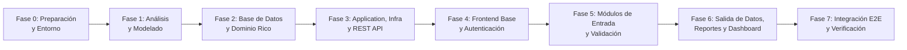
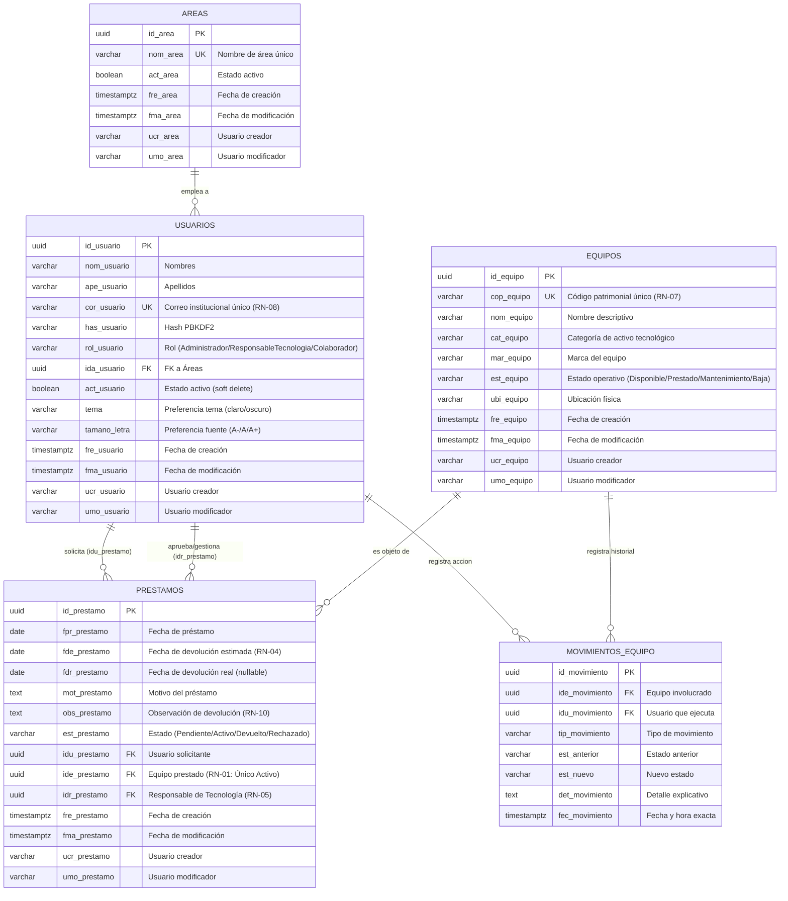
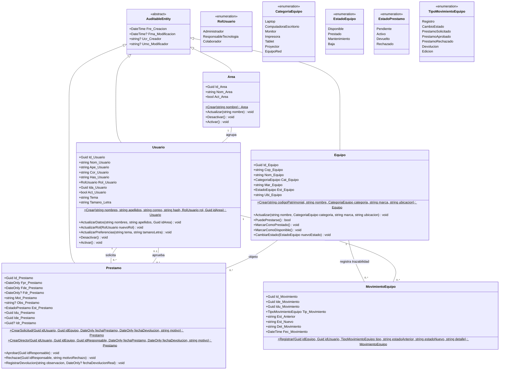
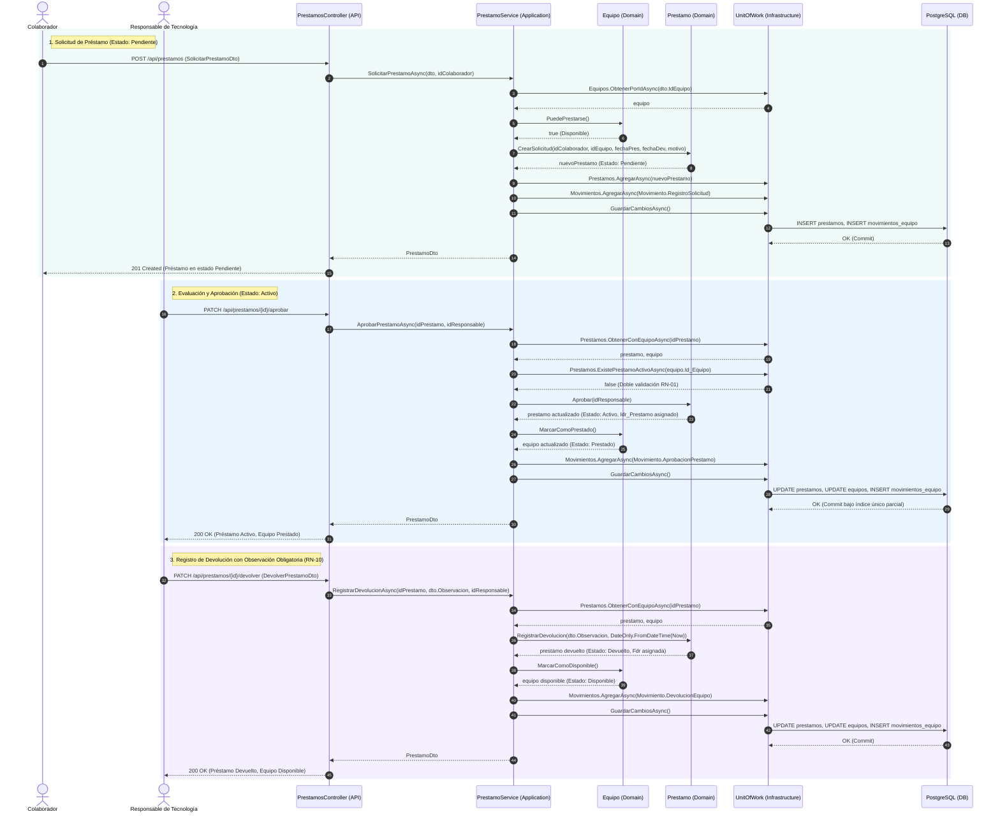

# Documento de Análisis y Planificación Técnica — TechAsset
**Sistema de Gestión de Inventario y Préstamo de Equipos Tecnológicos**  
**Organización:** Innovatech Solutions S.A.C.  
**Asignatura:** Construcción de Software — UPLA  

---

## 1. Presentación del Problema y Justificación

### 1.1. Contexto Organizacional
**Innovatech Solutions S.A.C.** es una empresa especializada en el desarrollo de soluciones de software para clientes nacionales e internacionales. Su fuerza laboral supera los 500 colaboradores organizados en múltiples áreas funcionales (Desarrollo, QA, Infraestructura, Soporte, Diseño, Gestión). Para desempeñar sus labores diarias, estos colaboradores requieren el uso intensivo de diversos activos tecnológicos:
- Laptops de alto rendimiento
- Computadoras de escritorio
- Monitores de alta resolución
- Impresoras multifuncionales
- Tablets para pruebas y diseño
- Proyectores multimedia para salas de reuniones
- Equipos de red y conectividad (switches, routers, APs)

### 1.2. Problemática Actual
Actualmente, el control de los activos tecnológicos y su asignación temporal se efectúa mediante planillas de cálculo y registros informales. Esta carencia de un sistema automatizado provoca:
1. **Pérdida de trazabilidad de activos:** Desconocimiento de quién tiene asignado cada equipo, en qué fecha lo recibió y quién autorizó el préstamo.
2. **Cruces e inconsistencias de inventario:** Se autorizan préstamos de equipos que ya están en uso, en mantenimiento preventivo o dados de baja.
3. **Falta de rigor en las devoluciones:** Los equipos retornan sin verificación técnica formal ni registro de observaciones sobre su estado físico y operativo.
4. **Ausencia de auditoría histórica:** No existe un registro inmutable de movimientos que permita auditar cambios de estado o identificar equipos con fallas recurrentes.
5. **Invisibilidad operativa:** La gerencia y los líderes de TI carecen de indicadores en tiempo real sobre disponibilidad, tasas de ocupación y distribución por áreas funcionales.

### 1.3. Propósito del Sistema TechAsset
Implementar una solución web corporativa, robusta y escalable que centralice el ciclo de vida completo de los activos tecnológicos: registro patrimonial, control de estados, solicitudes de préstamo por autoservicio, evaluación técnica por líderes autorizados, devoluciones con control de calidad y reportes analíticos para la toma de decisiones.

---

## 2. Objetivos del Proyecto

### 2.1. Objetivo General
Desarrollar una aplicación web integral para la gestión de inventario y préstamo de equipos tecnológicos aplicando principios de Clean Architecture, Programación Orientada a Objetos rica en invariantes, diseño accesible (WCAG 2.2 AA), validación de datos multinivel y pruebas automatizadas rigurosas.

### 2.2. Objetivos Específicos
1. **Analizar y modelar el dominio:** Identificar entidades, actores, reglas de negocio y restricciones técnicas para una empresa tecnológica de 500 colaboradores.
2. **Aplicar estándares de construcción de software:** Adoptar convenciones de código sólidas (C# / .NET 8, React / Vite / Tailwind), formateo unificado (`.editorconfig`, `.prettierrc`) y linter estricto (ESLint 9 sin advertencias).
3. **Garantizar la integridad de datos:** Implementar invariantes de dominio mediante Factory Methods, transacciones serializables con Unit of Work, y restricciones físicas en PostgreSQL (índices únicos parciales y CHECKs).
4. **Construir componentes desacoplados:** Diseñar módulos frontend reutilizables, modales agnósticos de dominio (`ModalDialog`), barras de filtrado genéricas (`FilterBar`) y servicios tipados.
5. **Verificar la calidad del software:** Cobertura de pruebas unitarias sobre el 100% de las reglas de negocio en el backend y pruebas de componentes accesibles con Vitest.

---

## 3. Actores del Sistema y Roles

El sistema define tres roles mutuamente excluyentes (Enum `RolUsuario`):

| Actor / Rol | Descripción y Alcance Operativo | Responsabilidades Principales |
| :--- | :--- | :--- |
| **Administrador** | Responsable supremo de la configuración, seguridad y control global del sistema. | • Gestión integral de usuarios (altas, bajas lógicas, asignación de roles y áreas).<br>• Registro y edición de equipos y áreas funcionales.<br>• Consulta de reportes ejecutivos e indicadores de desempeño (KPIs).<br>• Supervisión y consulta de préstamos históricos y activos. |
| **Responsable de Tecnología** | Personal técnico encargado de la custodia física y operativa de los activos. | • Registro y actualización técnica de equipos tecnológicos.<br>• Evaluación técnica (aprobación o rechazo fundamentado) de solicitudes de préstamo.<br>• Registro formal de devoluciones con evaluación física del equipo.<br>• Gestión de estados operativos (disponible, mantenimiento, baja).<br>• Consulta de inventario, movimientos y reportes. |
| **Colaborador** | Empleado de cualquier área funcional que requiere equipos para sus labores. | • Consulta del inventario de equipos disponibles para préstamo.<br>• Creación de solicitudes de préstamo indicando fecha estimada y justificación.<br>• Consulta del estado de sus propias solicitudes e historial personal. |

---

## 4. Requerimientos Funcionales (RF-01 a RF-17)

| Código | Módulo | Descripción Funcional | Actores Autorizados |
| :--- | :--- | :--- | :--- |
| **RF-01** | Usuarios | **Registrar usuarios:** Crear cuentas de colaboradores, administradores o responsables asignados a un área funcional. El correo institucional debe ser único. | Administrador |
| **RF-02** | Usuarios | **Actualizar usuarios:** Modificar nombres, apellidos, área funcional asignada y rol de un usuario existente. | Administrador |
| **RF-03** | Usuarios | **Consultar usuarios:** Listado paginado con búsqueda por nombre/correo, filtros por rol, estado y área funcional. | Administrador, ResponsableTecnologia (solo responsables) |
| **RF-04** | Usuarios | **Deshabilitar usuarios:** Desactivación lógica (`act_usuario = false`). Se bloquea si el usuario posee préstamos en estado `Activo`. | Administrador |
| **RF-05** | Inventario | **Registrar equipos tecnológicos:** Alta de equipos con código patrimonial único, nombre, categoría, marca, estado inicial y ubicación física. | Administrador, ResponsableTecnologia |
| **RF-06** | Inventario | **Actualizar equipos tecnológicos:** Modificación de datos descriptivos, marca, categoría y ubicación física del equipo. | Administrador, ResponsableTecnologia |
| **RF-07** | Inventario | **Consultar inventario de equipos:** Listado paginado con búsqueda por texto libre, filtros combinados por categoría, estado operativo y ubicación/área. | Todos (acceso general de consulta) |
| **RF-08** | Inventario | **Actualizar estado del equipo:** Cambio de estado operativo a `Disponible`, `Mantenimiento` o `Baja`. Se prohíbe si el equipo está en préstamo activo. | Administrador, ResponsableTecnologia |
| **RF-09** | Préstamos | **Registrar préstamos:** Solicitud de préstamo en estado `Pendiente` (por Colaborador) o registro directo en estado `Activo` (por Responsable/Admin con responsable asignado). | Colaborador (solicitar), Admin, ResponsableTecnologia |
| **RF-10** | Préstamos | **Registrar devoluciones:** Cierre formal de un préstamo activo, restableciendo el equipo a `Disponible` y exigiendo observación técnica obligatoria. | ResponsableTecnologia |
| **RF-11** | Préstamos | **Consultar historial de préstamos:** Listado histórico paginado con filtros por estado, fechas, colaborador y equipo. Alcance acotado para Colaborador. | Todos (con alcance por rol) |
| **RF-12** | Préstamos | **Consultar préstamos activos:** Vista operativa de todos los préstamos vigentes que están en posesión de colaboradores, con alertas de vencimiento. | Administrador, ResponsableTecnologia, Colaborador (propios) |
| **RF-13** | Reportes | **Visualizar dashboard general:** Panel central con 6 KPIs clave (Total equipos, Disponibles, Prestados, Mantenimiento, Total préstamos, Área líder), gráfica dona SVG y solicitudes pendientes. | Administrador, ResponsableTecnologia, Colaborador (versión reducida) |
| **RF-14** | Reportes | **Consultar equipos por estado:** Visualización analítica de la distribución porcentual y cuantitativa de activos por estado operativo. | Administrador, ResponsableTecnologia |
| **RF-15** | Reportes | **Consultar equipos más utilizados:** Ranking de activos tecnológicos ordenados por frecuencia acumulada de préstamos registrados. | Administrador, ResponsableTecnologia |
| **RF-16** | Reportes | **Consultar préstamos por área:** Reporte de asignación de equipos agrupados por área funcional del solicitante. | Administrador, ResponsableTecnologia |
| **RF-17** | Reportes | **Consultar historial de movimientos:** Registro inmutable de auditoría sobre cada cambio de estado, solicitud, aprobación, rechazo y devolución de activos. | Administrador, ResponsableTecnologia |

---

## 5. Reglas de Negocio (RN-01 a RN-10)

| Código | Regla de Negocio | Mecanismo de Control en el Backend | Restricción en Base de Datos |
| :--- | :--- | :--- | :--- |
| **RN-01** | **Unicidad de Préstamo Activo:** Un equipo tecnológico solo puede estar asociado a UN único préstamo en estado `Activo` simultáneamente. | Doble validación en `PrestamoService` verificando si existe algún préstamo con estado `Activo` para dicho equipo antes de aprobar. | **Índice único parcial en PostgreSQL:**<br>`CREATE UNIQUE INDEX uq_prestamo_activo_equipo ON prestamos (ide_prestamo) WHERE est_prestamo = 'Activo';` |
| **RN-02** | **Bloqueo de Préstamo en Mantenimiento:** No se puede solicitar ni aprobar el préstamo de un equipo que se encuentre en estado `Mantenimiento`. | Método de dominio `Equipo.PuedePrestarse()` retorna `false` y `PrestamoService` lanza `DomainException("El equipo se encuentra en mantenimiento.")`. | Validación de consistencia transaccional al cambiar estado a `Prestado`. |
| **RN-03** | **Bloqueo de Préstamo en Baja:** No se puede prestar un equipo en estado `Baja`. Es un estado terminal. | Método de dominio `Equipo.PuedePrestarse()` retorna `false` impidiendo cualquier operación de préstamo. | Validación de invariante en entidad `Equipo`. |
| **RN-04** | **Cronología de Devolución:** La fecha estimada de devolución (`Fde_Prestamo`) debe ser estrictamente posterior a la fecha del préstamo (`Fpr_Prestamo`). Igualmente, la devolución real (`Fdr_Prestamo`) debe ser igual o posterior a `Fpr_Prestamo`. | Invariante validada en Factory Methods `Prestamo.CrearSolicitud()` y `Prestamo.CrearDirecto()`. | **CHECK Constraint en PostgreSQL:**<br>`CHECK (fde_prestamo > fpr_prestamo)` y `CHECK (fdr_prestamo IS NULL OR fdr_prestamo >= fpr_prestamo)`. |
| **RN-05** | **Custodia Obligatoria por Responsable:** Ningún préstamo puede encontrarse en estado `Activo` sin tener asignado el identificador del Responsable de Tecnología (`Idr_Prestamo`). | Una solicitud inicial nace en `Pendiente` (`Idr_Prestamo = null`). Al aprobarse mediante `Prestamo.Aprobar(idResponsable)`, se asigna obligatoriamente el responsable evaluador. | **CHECK Constraint:**<br>`CHECK (est_prestamo <> 'Activo' OR idr_prestamo IS NOT NULL)`. |
| **RN-06** | **Integridad Histórica y Baja Lógica de Equipos:** No existe borrado físico (`DELETE`) de equipos tecnológicos. Si un equipo queda inoperativo u obsoleto, se marca en estado `Baja`. | Se bloquea el endpoint DELETE. Solo se expone actualización de estado a `Baja`. El historial de préstamos y movimientos permanece inmutable. | `DeleteBehavior.Restrict` en claves foráneas hacia `equipos`. |
| **RN-07** | **Unicidad de Código Patrimonial:** El código patrimonial (`cop_equipo`) asignado a cada activo tecnológico debe ser estrictamente único e irrepetible. | Verificación previa en `EquipoService` retornando `409 Conflict` si ya existe el código. | **Índice ÚNICO en PostgreSQL:**<br>`CREATE UNIQUE INDEX uq_equipos_cop ON equipos (cop_equipo);` |
| **RN-08** | **Unicidad de Correo Institucional:** Cada usuario debe poseer un correo electrónico corporativo único en el sistema. | Verificación en `UsuarioService` retornando `409 Conflict` ante duplicidad. | **Índice ÚNICO en PostgreSQL:**<br>`CREATE UNIQUE INDEX uq_usuarios_cor ON usuarios (cor_usuario);` |
| **RN-09** | **Protección de Desactivación de Usuarios:** Solo el Administrador puede deshabilitar/reactivar usuarios. Se prohíbe terminantemente desactivar a un usuario que posea préstamos vigentes (`Activo`). | `UsuarioService.CambiarEstadoAsync()` consulta si el usuario registra préstamos con `est_prestamo = 'Activo'`; si existen, lanza `DomainException` impidiendo la desactivación. | Validación transaccional en servicio y repositorio. |
| **RN-10** | **Observación Obligatoria en Devolución:** Todo registro de devolución física exige una observación no vacía (`Obs_Prestamo`) que describa la condición operativa en que retorna el activo. | Método de dominio `Prestamo.RegistrarDevolucion(obs)` valida `string.IsNullOrWhiteSpace(obs)` arrojando `DomainException`. | Verificación de obligatoriedad en DTO y dominio. |

---

## 6. Matriz de Trazabilidad Cruzada (RF ↔ RN ↔ Módulo ↔ Capas)

| Requerimiento Funcional | Reglas de Negocio Asociadas | Módulo | Capa Dominio / Entidades | Capa Aplicación (Servicios/DTOs) | Capa Infraestructura / BD | Capa API (Endpoints) | Capa Frontend (Vistas/Componentes) |
| :--- | :--- | :--- | :--- | :--- | :--- | :--- | :--- |
| **RF-01** Registrar usuarios | RN-08 | Usuarios | `Usuario.Crear()` | `UsuarioService`, `CrearUsuarioDto` | `UsuarioRepository`, `uq_usuarios_cor` | `POST /api/usuarios` | `/usuarios` (`ModalDialog` alta) |
| **RF-02** Actualizar usuarios | RN-08 | Usuarios | `Usuario.ActualizarDatos()`, `ActualizarRol()` | `UsuarioService`, `ActualizarUsuarioDto` | `UsuarioRepository` | `PUT /api/usuarios/{id}` | `/usuarios` (`ModalDialog` edición) |
| **RF-03** Consultar usuarios | — | Usuarios | `Usuario`, `Area` | `UsuarioService`, `UsuarioDto`, `PaginadoDto` | `UsuarioRepository` (AsNoTracking) | `GET /api/usuarios` | `/usuarios` (`TableList`, `FilterBar`) |
| **RF-04** Deshabilitar usuarios | RN-09 | Usuarios | `Usuario.Desactivar()`, `Activar()` | `UsuarioService.CambiarEstadoAsync` | Verificación préstamos activos | `PATCH /api/usuarios/{id}/estado` | `/usuarios` (`ModalDialog` confirmación) |
| **RF-05** Registrar equipos | RN-06, RN-07 | Inventario | `Equipo.Crear()` | `EquipoService`, `CrearEquipoDto` | `EquipoRepository`, `uq_equipos_cop` | `POST /api/equipos` | `/equipos` (`ModalDialog` alta) |
| **RF-06** Actualizar equipos | RN-07 | Inventario | `Equipo.Actualizar()` | `EquipoService`, `ActualizarEquipoDto` | `EquipoRepository` | `PUT /api/equipos/{id}` | `/equipos` (`ModalDialog` edición) |
| **RF-07** Consultar inventario | — | Inventario | `Equipo`, `EstadoEquipo` | `EquipoService`, `ParametrosConsultaEquipos` | Consultas filtradas AsNoTracking | `GET /api/equipos` | `/equipos` (`FilterBar`, `TableList`) |
| **RF-08** Actualizar estado equipo | RN-01, RN-06 | Inventario | `Equipo.CambiarEstado()`, `PuedePrestarse()` | `EquipoService.CambiarEstadoAsync` | Validación préstamo activo | `PATCH /api/equipos/{id}/estado` | `/equipos` (`ModalDialog` estado) |
| **RF-09** Registrar préstamo | RN-01, 02, 03, 04, 05 | Préstamos | `Prestamo.CrearSolicitud()`, `CrearDirecto()` | `PrestamoService.SolicitarAsync` | UoW + `uq_prestamo_activo_equipo` | `POST /api/prestamos` | `/prestamos` (`ModalDialog` solicitud) |
| **RF-10** Registrar devolución | RN-10 | Préstamos | `Prestamo.RegistrarDevolucion()`, `Equipo.MarcarComoDisponible()` | `PrestamoService.RegistrarDevolucionAsync` | Transacción UoW + `movimientos_equipo` | `PATCH /api/prestamos/{id}/devolver` | `/prestamos` (`ModalDialog` devolución) |
| **RF-11** Historial de préstamos | — | Préstamos | `Prestamo`, `MovimientoEquipo` | `PrestamoService.ObtenerHistorialAsync` | Paginación indexada | `GET /api/prestamos/historial` | `/prestamos` (Pestaña Historial) |
| **RF-12** Préstamos activos | RN-01 | Préstamos | `Prestamo`, `Equipo`, `Usuario` | `PrestamoService.ObtenerActivosAsync` | Filtro `est_prestamo = 'Activo'` | `GET /api/prestamos/activos` | `/prestamos` (Pestaña Activos) |
| **RF-13** Dashboard general | — | Reportes | Agregaciones LINQ | `ReporteService.ObtenerDashboardAsync` | Consultas optimizadas con AsNoTracking | `GET /api/reportes/dashboard` | `/panel` (`CardIndicador`, SVG Dona) |
| **RF-14** Equipos por estado | — | Reportes | `EstadoEquipo` | `ReporteService.ObtenerEquiposPorEstadoAsync` | `GROUP BY est_equipo` | `GET /api/reportes/equipos-por-estado` | `/reportes` (Pestaña Estados) |
| **RF-15** Equipos más utilizados | — | Reportes | `Prestamo` | `ReporteService.ObtenerMasUtilizadosAsync` | `GROUP BY ide_prestamo ORDER BY count DESC`| `GET /api/reportes/equipos-mas-utilizados`| `/reportes` (Ranking de equipos) |
| **RF-16** Préstamos por área | — | Reportes | `Area`, `Usuario`, `Prestamo` | `ReporteService.ObtenerPorAreaAsync` | `JOIN usuarios JOIN areas GROUP BY nom_area` | `GET /api/reportes/prestamos-por-area`| `/reportes` (Distribución por área) |
| **RF-17** Historial de movimientos | — | Reportes | `MovimientoEquipo` | `ReporteService.ObtenerMovimientosAsync` | Tabla inmutable `movimientos_equipo` | `GET /api/reportes/movimientos` | `/reportes` (Bitácora de movimientos) |

---

## 7. Ciclo de Vida Seleccionado y Justificado

### 7.1. Modelo Seleccionado: Desarrollo Iterativo e Incremental bajo Scrum Ligero
Para la construcción del sistema TechAsset se ha adoptado el **Ciclo de Vida Iterativo e Incremental**, adaptado a un esquema de **Scrum Ligero** guiado por la metodología ODD (*Organic Driven Development*).



### 7.2. Justificación Técnica de la Selección
1. **Descomposición Arquitectónica Limpia:** La arquitectura Clean Architecture exige que las capas internas (Dominio) se construyan y estabilicen antes de las capas externas (Infraestructura, Controladores y Frontend). Un modelo iterativo permite asegurar la solidez de las invariantes antes de exponerlas en la API.
2. **Mitigación Temprana de Riesgos:** Las reglas críticas de negocio (como el índice único parcial para evitar duplicidad de préstamos activos RN-01 o la interceptación de auditoría en EF Core) se resuelven y prueban unitariamente en las primeras iteraciones, eliminando fallas estructurales tardías.
3. **Compuertas de Calidad por Fase (Quality Gates):** Cada iteración concluye con una compilación limpia (`0 warnings, 0 errors`), ejecución de pruebas unitarias/integración automatizadas y verificación de código estático (ESLint 9 y dotnet analyzers). No se avanza a la siguiente fase sin la superación del 100% de las pruebas.
4. **Visibilidad y Adaptabilidad:** Permite entregar incrementos de software funcionales y demostrables en cada etapa (Dominio testeable → API REST testeable con xUnit → Vistas React integradas con Vitest).

---

## 8. Estándares de Construcción de Software

### 8.1. Arquitectura de Software: Clean Architecture
El backend sigue de manera rigurosa la separación de responsabilidades en cuatro capas concéntricas con regla de dependencia unidireccional hacia el centro:

```
TechAsset.Api              (Controladores, Middlewares, Auth por Cookie, Rate Limit)
       │
       ▼
TechAsset.Infrastructure   (EF Core AppDbContext, PostgreSQL, Repositorios, Seeder)
       │
       ▼
TechAsset.Application      (Servicios de Aplicación, DTOs Records, Mappers, Interfaces)
       │
       ▼
TechAsset.Domain           (Entidades Ricas, Enums, Excepciones, Reglas de Negocio)
```

- **Patrones Implementados:** Repository, Unit of Work, Parameter Objects para filtrado, DTOs inmutables (`record`), Static Extension Mappers.
- **Prohibiciones Explícitas:** No se utilizan librerías de indirección o mapeo dinámico como MediatR, AutoMapper o Specification Pattern. Todo el flujo es transparente y rastreable paso a paso.

### 8.2. Estándares de Nomenclatura en C# (.NET 8)
- **Clases, Métodos, Propiedades públicas y Enums:** `PascalCase` (ej. `PrestamoService`, `ObtenerPorIdAsync`, `EstadoPrestamo`).
- **Interfaces:** Prefijo `I` seguido de `PascalCase` (ej. `IPrestamoRepository`, `IUnitOfWork`).
- **Campos privados:** `_camelCase` (ej. `_context`, `_passwordHasher`).
- **DTOs:** Sufijo `Dto` con estructura inmutable `public record PrestamoDto(...)`.
- **Propiedades de Entidades en Dominio:** Mnemotécnico de 3 letras con guión bajo para mapear consistentemente con la base de datos:
  - Áreas: `Id_Area`, `Nom_Area`, `Act_Area`
  - Usuarios: `Id_Usuario`, `Nom_Usuario`, `Ape_Usuario`, `Cor_Usuario`, `Has_Usuario`, `Rol_Usuario`, `Ida_Usuario`, `Act_Usuario`
  - Equipos: `Id_Equipo`, `Cop_Equipo`, `Nom_Equipo`, `Cat_Equipo`, `Mar_Equipo`, `Est_Equipo`, `Ubi_Equipo`
  - Préstamos: `Id_Prestamo`, `Fpr_Prestamo`, `Fde_Prestamo`, `Fdr_Prestamo`, `Mot_Prestamo`, `Obs_Prestamo`, `Est_Prestamo`, `Idu_Prestamo`, `Ide_Prestamo`, `Idr_Prestamo`
  - Movimientos: `Id_Movimiento`, `Ide_Movimiento`, `Idu_Movimiento`, `Tip_Movimiento`, `Est_Anterior`, `Est_Nuevo`, `Det_Movimiento`, `Fec_Movimiento`

### 8.3. Estándares de Base de Datos (PostgreSQL 16+)
- **Tablas:** Minúsculas en plural snake_case (`areas`, `usuarios`, `equipos`, `prestamos`, `movimientos_equipo`).
- **Columnas:** snake_case con prefijo mnemotécnico de 3 letras (`cop_equipo`, `fpr_prestamo`).
- **Claves Primarias:** UUID v4 generados en aplicación (`Guid.NewGuid()`).
- **Mapeo:** 100% Fluent API en `AppDbContext.OnModelCreating` mediante métodos privados `ConfigurarXxx`. Cero DataAnnotations en entidades de dominio.
- **Integridad Referencial:** `DeleteBehavior.Restrict` en todas las claves foráneas para preservar trazabilidad histórica.

### 8.4. Estándares de Frontend (React 18 + Tailwind CSS)
- **Componentes:** Archivos y nombres en `PascalCase.jsx`.
- **Hooks personalizados:** Prefijo `useXxx.js` en `camelCase`.
- **Servicios y Utilidades:** Archivos en `camelCase.js`.
- **Constantes:** `UPPER_SNAKE_CASE` agrupadas en objetos congelados con `Object.freeze()`.
- **Accesibilidad (WCAG 2.2 Nivel AA):** 
  - Foco visible con anillos de contraste.
  - Trampa de foco y restauración en ventanas modales (`useTrampaFoco`).
  - Roles ARIA semánticos (`role="alert"`, `aria-describedby`, `aria-labelledby`).
  - Objetivos táctiles mínimos de 44x44px.
  - Conmutador accesible de tema claro/oscuro y tamaño de letra tipográfica (A- / A / A+).

### 8.5. Estándares de Control de Versiones (Git)
- **Mensajes de Commit:** Formato convencional (*Conventional Commits*):
  `feat:`, `fix:`, `chore:`, `refactor:`, `test:`, `docs:`
- **Regla Estricta:** Prohibido agregar líneas "Co-Authored-By" o atribuciones automáticas de IA.
- **Estrategia de Ramas:** Ramas temáticas `feature/fase-X-...` con fusión limpia a `main` al completar y verificar cada fase.

---

## 9. Diagramas Técnicos en Mermaid

### 9.1. Diagrama de Casos de Uso del Sistema

```mermaid
graph TD
    subgraph Actores
        Admin["Administrador"]
        Resp["Responsable de Tecnología"]
        Colab["Colaborador"]
    end

    subgraph "Módulo de Usuarios"
        CU01["RF-01: Registrar Usuario"]
        CU02["RF-02: Actualizar Usuario"]
        CU03["RF-03: Consultar Usuarios"]
        CU04["RF-04: Deshabilitar/Reactivar Usuario"]
    end

    subgraph "Módulo de Inventario (Equipos)"
        CU05["RF-05: Registrar Equipo Tecnológico"]
        CU06["RF-06: Actualizar Equipo"]
        CU07["RF-07: Consultar Inventario de Equipos"]
        CU08["RF-08: Actualizar Estado del Equipo"]
    end

    subgraph "Módulo de Préstamos"
        CU09["RF-09: Solicitar/Registrar Préstamo"]
        CU10["RF-10: Aprobar / Rechazar Préstamo"]
        CU11["RF-10: Registrar Devolución con Observación"]
        CU12["RF-11/12: Consultar Préstamos (Activos e Historial)"]
    end

    subgraph "Módulo de Dashboard y Reportes"
        CU13["RF-13: Visualizar Dashboard General"]
        CU14["RF-14: Reporte de Equipos por Estado"]
        CU15["RF-15: Reporte de Equipos Más Utilizados"]
        CU16["RF-16: Reporte de Préstamos por Área"]
        CU17["RF-17: Historial de Movimientos de Equipos"]
    end

    Admin --> CU01
    Admin --> CU02
    Admin --> CU03
    Admin --> CU04
    Admin --> CU05
    Admin --> CU06
    Admin --> CU07
    Admin --> CU08
    Admin --> CU09
    Admin --> CU12
    Admin --> CU13
    Admin --> CU14
    Admin --> CU15
    Admin --> CU16
    Admin --> CU17

    Resp --> CU03
    Resp --> CU05
    Resp --> CU06
    Resp --> CU07
    Resp --> CU08
    Resp --> CU09
    Resp --> CU10
    Resp --> CU11
    Resp --> CU12
    Resp --> CU13
    Resp --> CU14
    Resp --> CU15
    Resp --> CU16
    Resp --> CU17

    Colab --> CU07
    Colab --> CU09
    Colab --> CU12
```


---

### 9.2. Diagrama Entidad-Relación (ERD)


---

### 9.3. Diagrama de Clases del Dominio


---

### 9.4. Diagrama de Secuencia del Flujo de Préstamo (Solicitud, Aprobación, Devolución)


---

## 10. Dashboard Mínimo y Métricas Operativas

Conforme a la sección 10 del caso práctico, el sistema despliega en `/panel` los siguientes indicadores:

| Indicador (KPI) | Descripción Operativa |
| :--- | :--- |
| **Total de Equipos** | Cantidad total de activos tecnológicos registrados en el catálogo de Innovatech. |
| **Equipos Disponibles** | Equipos en estado `Disponible` listos para ser asignados de forma inmediata. |
| **Equipos Prestados** | Equipos en custodia temporal de colaboradores con préstamo en estado `Activo`. |
| **Equipos en Mantenimiento** | Equipos que se encuentran en reparación, actualización o revisión técnica preventiva. |
| **Total de Préstamos** | Cantidad histórica consolidada de solicitudes de préstamo procesadas por el sistema. |
| **Área con Mayor Uso** | Área funcional con el mayor número acumulado de préstamos otorgados. |

Adicionalmente, el panel incluye:
- **Gráfica de Dona SVG nativa:** Visualización porcentual de la distribución de equipos según su estado operativo (`Disponible`, `Prestado`, `Mantenimiento`, `Baja`).
- **Ranking de Préstamos por Área:** Gráfica de barras horizontales mostrando la intensidad de uso por área funcional.
- **Bandeja de Solicitudes Pendientes:** Acceso directo para que el Responsable de Tecnología evalúe y resuelva las solicitudes en espera.
