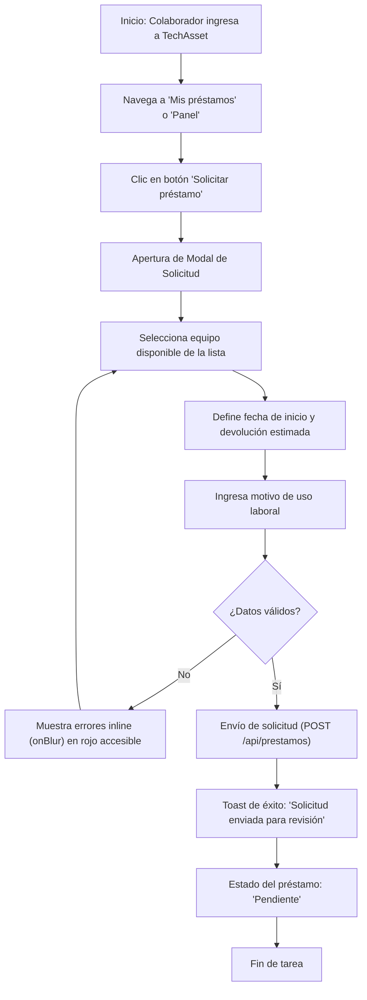
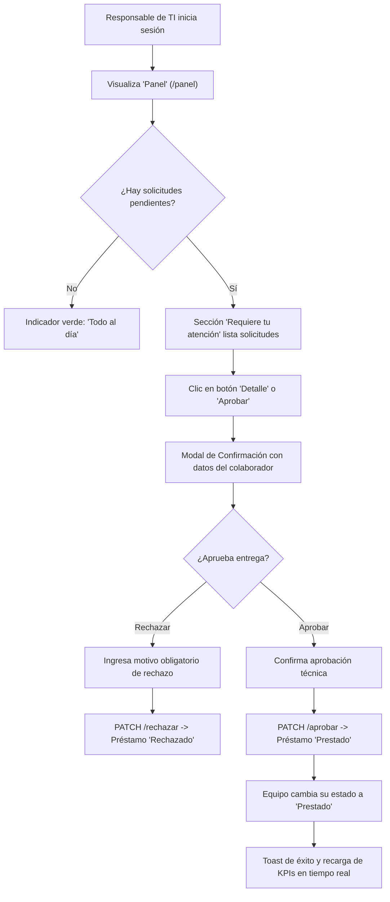
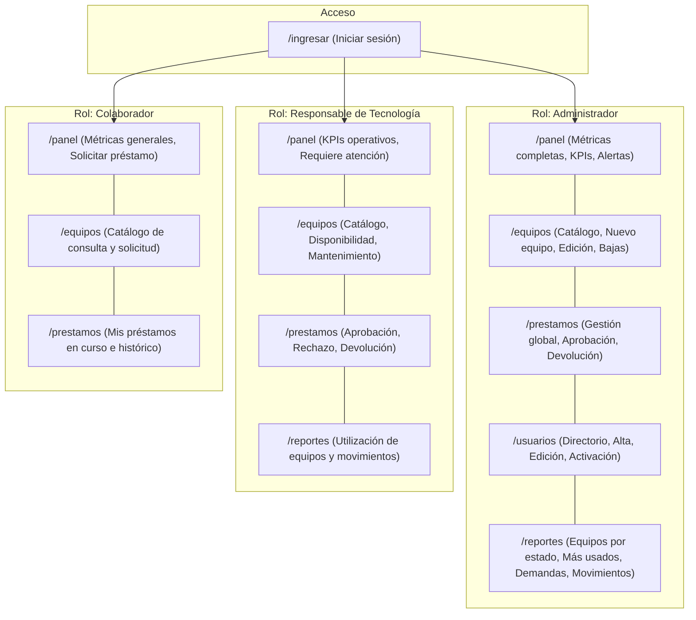

# Auditoría Integral de Experiencia de Usuario (UX), Usabilidad y Accesibilidad · TechAsset

> **Sistema:** TechAsset — Plataforma Corporativa de Gestión de Inventario y Control de Préstamos Tecnológicos  
> **Empresa:** Innovatech Solutions S.A.C.  
> **Estándares:** Nielsen Norman Group (10 Heurísticas), Shneiderman (8 Reglas de Oro), ISO 9241-210 (DCU), ISO 9241-110 (Ergonomía de Interacción), W3C WCAG 2.2 Nivel AA.  
> **Fecha:** Noviembre 2026  
> **Versión de Interfaz:** v3 (Fidelidad total a ReservaUPLA con Colorimetría Corporativa Cian + Azul Marino)

---

## 1. Evaluación Heurística de Nielsen (10 Heurísticas de Usabilidad)

Evaluación pantalla por pantalla del sistema TechAsset según las 10 heurísticas de Jakob Nielsen, registrando problemas identificados previamente, severidad (Escala 0–4) y la solución arquitectónica implementada.

*Escala de Severidad Nielsen:*
- **0:** No es un problema de usabilidad.
- **1:** Problema cosmético / superficial (se soluciona si hay tiempo).
- **2:** Problema menor (baja prioridad).
- **3:** Problema mayor (alta prioridad, frustra al usuario).
- **4:** Catástrofe de usabilidad (bloquea la operación, prioridad crítica).

### 1.1. Pantalla por Pantalla

| Pantalla | Heurística Nielsen | Problema / Violación Previa | Severidad | Solución Implementada en TechAsset | Estado |
| :--- | :--- | :--- | :---: | :--- | :---: |
| **Login (`/ingresar`)** | **H1:** Visibilidad del estado del sistema | Mensajes de error como "Ingrese su correo..." aparecían al montar la pantalla sin interacción del usuario. | 3 | Validación pospuesta a `onBlur` o intento de envío (`alEnviar`), conservando campos limpios al inicio. | Resuelto |
| **Login (`/ingresar`)** | **H5:** Prevención de errores | Banner de error con bajo contraste (rosado sobre rosado) ilegible para el usuario. | 3 | Tokens semánticos de error (`#FDE2E2` fondo, `#B91C1C` borde, `#7F1D1D` texto) con contraste $>7:1$ e ícono. | Resuelto |
| **Login (`/ingresar`)** | **H8:** Estética y diseño minimalista | Layout de una sola columna centrada sin contexto de marca corporativa. | 2 | Layout de dos paneles idéntico a ReservaUPLA: panel izquierdo con imagen de laboratorio TI, overlay gradiente y viñetas; tarjeta derecha elevada. | Resuelto |
| **Panel (`/panel`)** | **H1:** Visibilidad del estado del sistema | Datos en 0 con mensaje "No se pudo cargar la información del panel" por falla de traducción EF Core. | 4 | Corrección en LINQ `PrestamoRepository` y desacople de consultas. Conexión de 6 KPIs con datos reales de base de datos. | Resuelto |
| **Panel (`/panel`)** | **H2:** Correspondencia entre sistema y mundo real | Título "Dashboard" y saludo informal "Bienvenido, Carlos" en lugar de terminología estándar de trabajo. | 2 | Título formal "Panel" con subtítulo claro, franja de resumen de actividad ("Hoy", "Esta semana") y sección "Requiere tu atención". | Resuelto |
| **Panel (`/panel`)** | **H7:** Flexibilidad y eficiencia de uso | Falta de accesos directos para aprobar o rechazar solicitudes pendientes de colaboradores. | 3 | Componente `RequiereAtencion` con botones directos `[Detalle]`, `[Aprobar]`, `[Rechazar]` y avatares con iniciales. | Resuelto |
| **Equipos (`/equipos`)** | **H2:** Correspondencia entre sistema y mundo real | Enums de base de datos crudos en pantalla (`ComputadoraEscritorio`, `EquipoRed`). | 3 | Diccionario canónico `etiquetas.js` y componente `CategoriaEquipoChip` con ícono y texto en lenguaje natural. | Resuelto |
| **Equipos (`/equipos`)** | **H4:** Consistencia y estándares | Filtros en dos filas desalineadas con etiqueta redundant "FILTROS". Códigos patrimoniales con estilo de enlace azul. | 3 | `FiltrosEquipos` en una sola fila compacta con búsqueda con debounce, selectores, contador "N equipos encontrados", botón "Limpiar filtros", y código patrimonial en fuente monoespaciada neutra. | Resuelto |
| **Equipos (`/equipos`)** | **H5:** Prevención de errores | Botón de desactivar o mandar a mantenimiento un equipo con préstamo en curso provocaba inconsistencia. | 4 | `AccionesFilaEquipo` deshabilita el cambio de estado si el equipo está `Prestado`, mostrando tooltip explicativo de prevención. | Resuelto |
| **Préstamos (`/prestamos`)** | **H9:** Reconocer, diagnosticar y recuperarse de errores | TypeError `reiniciar is not a function` al abrir modal de solicitar préstamo provocaba pantalla blanca sin recuperación. | 4 | Global `ErrorBoundary` para atrapar fallos de render sin exponer stack trace, y normalización estricta de la API de `useFormulario`. | Resuelto |
| **Préstamos (`/prestamos`)** | **H3:** Control y libertad del usuario | Acciones vacías en listado y falta de visualización del motivo u observaciones técnicas. | 3 | Inclusión de botón `[Detalle]` con modal accesible `ModalDetallePrestamo`, pestañas de estado con contadores reales y modales de aprobación/devolución. | Resuelto |
| **Usuarios (`/usuarios`)** | **H8:** Estética y diseño minimalista | Píldoras de estado con texto blanco sobre verde menta ilegible (`<2.5:1`), incumpliendo WCAG AA. | 3 | Píldoras de estado con tokens sólidos `bg-exito-fondo`/`text-exito-texto` y `bg-peligro-fondo`/`text-peligro-texto` con contraste $>7:1$. | Resuelto |
| **Usuarios (`/usuarios`)** | **H5:** Prevención de errores | Administrador podía desactivar accidentalmente su propia cuenta y quedar bloqueado del sistema. | 4 | `AccionesFilaUsuario` detecta si el usuario de la fila es la sesión activa y deshabilita el botón con tooltip: "No puede desactivar su propia cuenta". | Resuelto |
| **Reportes (`/reportes`)** | **H10:** Ayuda y documentación / H8: Minimalismo | Cabecera tapada/superpuesta y presencia de códigos internos técnicos de especificación ("RF-17"). | 2 | Estandarización con `PageContainer` y `EncabezadoPagina`. Eliminación absoluta de códigos "RF-" o "RN-", organizando 4 pestañas ejecutivas claras. | Resuelto |

---

## 2. Aplicación de las 8 Reglas de Oro de Shneiderman

Ben Shneiderman formuló 8 principios fundamentales para el diseño de interfaces de usuario efectivas. A continuación se detalla su aplicación técnica en TechAsset:

```
+-----------------------------------------------------------------------------------+
|                     8 REGLAS DE ORO DE BEN SHNEIDERMAN EN TECHASSET               |
+-----------------------------------------------------------------------------------+
| 1. Esforzarse por la consistencia          -> tokens.css, PageContainer, TableList|
| 2. Permitir el uso de atajos universales    -> Tecla Esc en modales, focus trapping|
| 3. Ofrecer retroalimentación informativa   -> Toast emergentes, badges con íconos |
| 4. Diseñar diálogos que indiquen cierre    -> Modales de confirmación con 2 pasos |
| 5. Prevenir errores antes de que ocurran   -> Botones deshabilitados con tooltip  |
| 6. Permitir la fácil reversión de acciones -> Deshacer en toasts y reactivación   |
| 7. Fomentar el locus interno de control    -> El usuario decide cuándo enviar datos|
| 8. Reducir la sobrecarga de memoria corta  -> Filtros con debounce y contadores   |
+-----------------------------------------------------------------------------------+
```

### Regla 1: Esforzarse por la consistencia (Strive for consistency)
- **Implementación:** Todas las páginas de datos (`Equipos`, `Préstamos`, `Usuarios`, `Reportes`) comparten la misma jerarquía estructural: `EncabezadoPagina` $\rightarrow$ Barra compacta de filtros en una fila $\rightarrow$ Pestañas de estado $\rightarrow$ `TableList` $\rightarrow$ `PaginacionTabla`.
- **Diseño visual:** Clases Tailwind unificadas a través de `tokens.css` (alturas mínimas de control táctil de 44px, radios estándar `rounded-tarjeta`, `rounded-control`, `rounded-pill`).

### Regla 2: Permitir a los usuarios frecuentes usar atajos (Cater to universal usability)
- **Implementación:** Los modales (`ModalGuiaNormativa`, `ModalDetallePrestamo`, `ModalConfirmacion`) se cierran instantáneamente pulsando la tecla `Escape`.
- **Navegación por teclado:** Enlace directo de accesibilidad "Saltar al contenido principal" (`#contenido-principal`), trampas de foco en modales (`trapFocus`) y foco visible de alto contraste con anillo de 2px `focus:ring-anillo-foco`.

### Regla 3: Ofrecer retroalimentación informativa (Offer informative feedback)
- **Implementación:** Toda mutación exitosa (alta de equipo, solicitud de préstamo, aprobación, rechazo, devolución) despacha una notificación no intrusiva mediante el componente `Toast` con rol `status` o `alert`.
- **Estados de carga:** Skeleton screens animados en `TableList` durante las solicitudes asíncronas para evitar saltos de interfaz (layout shifts).

### Regla 4: Diseñar diálogos que indiquen finalización (Design dialogs to yield closure)
- **Implementación:** Los flujos críticos (aprobar un préstamo, rechazar especificando motivo, desactivar una cuenta de usuario) no ocurren de manera silenciosa: abren modales de confirmación con títulos explicativos, resumen del recurso afectado y botones con etiquetas verbales unívocas ("Aprobar préstamo", "Confirmar rechazo", "Desactivar usuario").

### Regla 5: Prevenir errores (Prevent errors)
- **Implementación:** 
  1. En `AccionesFilaEquipo`, si un equipo se encuentra en estado `Prestado`, el botón para cambiar de estado operativo se deshabilita con cursor `not-allowed` y tooltip explicativo.
  2. En `AccionesFilaUsuario`, un administrador no puede desactivar su propio registro.
  3. Los campos de fecha en `FormularioSolicitarPrestamo` validan que la fecha de devolución sea posterior a la fecha de inicio antes de permitir el envío.

### Regla 6: Permitir la fácil reversión de acciones (Permit easy reversal of actions)
- **Implementación:** Las cuentas de usuario desactivadas no se destruyen de la base de datos (eliminación lógica); permanecen en la pestaña "Inactivos" y pueden reactivarse con un solo clic.

### Regla 7: Fomentar el locus interno de control (Support internal locus of control)
- **Implementación:** El usuario tiene control total sobre el filtrado y paginación. Los parámetros de búsqueda se reflejan en la URL (`?estado=...&texto=...`), permitiendo al usuario compartir búsquedas, refrescar o retroceder en el historial de navegación sin perder su estado.

### Regla 8: Reducir la sobrecarga de la memoria a corto plazo (Reduce short-term memory load)
- **Implementación:** Los filtros cuentan con contadores en tiempo real ("17 equipos encontrados") y un botón explícito "Limpiar filtros" que aparece únicamente cuando hay filtros activos, evitando que el operador deba recordar qué filtros activó.

---

## 3. Diseño Centrado en el Usuario (DCU / ISO 9241-210)

El estándar **ISO 9241-210** define los principios y actividades para el diseño de sistemas interactivos centrados en las personas. Se definieron tres perfiles de usuario corporativo con sus modelos mentales y necesidades operativas.

### 3.1. Perfiles de Usuario (User Personas)

```
+----------------------------------------------------------------------------------------------------+
|                                    PERFILES DE USUARIO (PERSONAS)                                  |
+------------------------------------+--------------------------------+------------------------------+
| 1. Carlos Mendoza (Administrador)  | 2. Elena Huamán (Resp. TI)     | 3. Marco Paredes (Colaborad.)|
| Área: Soporte TI                   | Área: Soporte TI / Redes       | Área: Desarrollo de Software |
| Nivel técnico: Avanzado            | Nivel técnico: Intermedio/Alto  | Nivel técnico: Intermedio    |
| Objetivo: Gobernanza y auditoría   | Objetivo: Custodia y despacho  | Objetivo: Préstamo productivo|
+------------------------------------+--------------------------------+------------------------------+
```

1. **Administrador del Sistema (Carlos Mendoza):**
   - *Responsabilidad:* Supervisar el inventario patrimonial completo, gestionar altas/bajas de usuarios, asignar roles y auditar reportes históricos de movimientos.
   - *Puntos de dolor previos:* No poder identificar qué áreas demandaban más equipos; interfaces confusas con nomenclaturas técnicas crudas.
   - *Solución:* Vista completa del `Sidebar`, KPIs ejecutivos, gráficos de dona/proporción en Panel y Reportes, control RBAC seguro.

2. **Responsable de Tecnología / Custodio (Elena Huamán):**
   - *Responsabilidad:* Revisar solicitudes de equipos, verificar stock disponible, aprobar/rechazar entregas y registrar devoluciones constatando el estado físico.
   - *Puntos de dolor previos:* Bandejas de pendientes inexistentes o lentas; tener que navegar entre múltiples pantallas para aprobar una entrega.
   - *Solución:* Sección `Requiere tu atención` en el Panel con aprobación/rechazo en un clic; modal de devolución con registro de observación técnica.

3. **Colaborador / Solicitante (Marco Paredes):**
   - *Responsabilidad:* Solicitar equipos tecnológicos (laptops de alto rendimiento, kits de prueba, accesorios) para cumplir sus proyectos corporativos.
   - *Puntos de dolor previos:* Pantalla colapsaba por errores de JavaScript al pulsar "Solicitar préstamo"; interfaz llena de opciones irrelevantes que no tenía permiso de usar.
   - *Solución:* Vista reducida adaptada a su rol ("Mis préstamos"), modal limpio de solicitud con catálogo de equipos disponibles y validación amigable.

---

### 3.2. Flujos de Tarea Principales (Task Flows en Mermaid)

#### Flujo 1: Solicitud de Préstamo por un Colaborador



#### Flujo 2: Aprobación y Entrega por el Responsable de TI



#### Flujo 3: Devolución e Inspección Técnica

```mermaid
flowchart LR
    A["Colaborador devuelve equipo físicamente"] --> B["Responsable TI abre '/prestamos'"]
    B --> C["Filtra por pestaña 'Activos'"]
    C --> D["Clic en botón 'Devolver'"]
    D --> E["Modal 'Registrar Devolución'"]
    E --> F["Verifica fecha real e ingresa condición física"]
    F --> G["Confirma devolución"]
    G --> H["PATCH /devolver"]
    H --> I["Préstamo pasa a 'Devuelto'"]
    I --> J["Equipo retorna a 'Disponible'"]
    J --> K["Se registra movimiento en Auditoría"]
```



---

## 4. Arquitectura de la Información

### 4.1. Taxonomía de Entidades del Dominio

```
                       [INNOVATECH SOLUTIONS S.A.C.]
                                    |
      +-----------------------------+-----------------------------+
      |                             |                             |
 [USUARIOS]                     [EQUIPOS]                    [PRÉSTAMOS]
  - ID / Guid                    - Cód. Patrimonial           - ID / Guid
  - Nombres / Apellidos          - Nombre / Modelo            - Solicitante
  - Correo corporativo           - Marca                      - Equipo tecnológico
  - Rol RBAC                     - Categoría (Laptop, etc.)   - Responsable TI
  - Área de pertenencia          - Ubicación física           - Fecha inicio
  - Estado (Activo/Inactivo)     - Estado operativo           - Fecha dev. estimada
                                 - Movimientos asociados      - Fecha dev. real
                                                              - Estado (Pendiente, etc.)
```

### 4.2. Mapa del Sitio por Rol (Sitemap en Mermaid)



### 4.3. Jerarquía y Mecanismos de Navegación

1. **Barra Lateral (`Sidebar`):**
   - Ubicada a la izquierda (fija en escritorio, colapsable en móvil).
   - Cabecera con imagen oficial `logo-techasset.png` (sin fondos duros), título "TechAsset" y subtítulo "Gestión de activos".
   - Elementos de navegación dinámicos filtrados por permisos RBAC (`obtenerItemsNavegacion`).
   - Estado activo: fondo sutil `bg-lateral-activo-fondo` (`#12335F`) con barra vertical acento de 3px `#06A3DA`.
   - Pie con bloque `UsuarioLateral`: avatar con iniciales, nombre, rol y botón accesible de cerrar sesión.

2. **Cabecera Superior (`Header`):**
   - Altura estándar de 4rem (64px) con fondo de superficie y borde inferior.
   - `MigasDePan` dinámicas a la izquierda ("Inicio > Equipos", "Inicio > Préstamos").
   - Botón "Guía" que despliega `ModalGuiaNormativa` (6 tarjetas informativas de buenas prácticas).
   - Controles de accesibilidad: conmutador de tamaño de letra (`A`, `A+`, `A++`) y botón de conmutador de tema (`Modo claro` / `Modo oscuro`).
   - Menú desplegable de usuario (`MenuUsuario`) a la derecha con iniciales y correo.

3. **Contenedor Universal (`PageContainer` y `EncabezadoPagina`):**
   - Ancho máximo `max-w-[1440px]`, centrado automático, espaciado uniforme `space-y-5`.
   - Título `h1` semántico con foco al montar accesible (`useFocoAlMontar`) y botón de acción principal a la derecha.

---

## 5. Lista de Verificación de Accesibilidad (WCAG 2.2 Nivel AA)

### 5.1. Medición de Ratios de Contraste (Colorimetría v3)

Requisito WCAG 2.2 AA: Texto normal $\ge 4.5:1$, texto grande $\ge 3.0:1$, bordes de control y foco $\ge 3.0:1$.

| Par de Elemento | Modo Claro | Ratio Claro | Modo Oscuro | Ratio Oscuro | Cumple WCAG AA |
| :--- | :--- | :---: | :--- | :---: | :---: |
| **Texto base / Superficie** | `#0F172A` sobre `#FFFFFF` | **15.4:1** | `#E8EEF9` sobre `#121C33` | **12.1:1** | Sí (Excelente) |
| **Texto suave / Superficie** | `#4A5568` sobre `#FFFFFF` | **7.3:1** | `#A9B8D4` sobre `#121C33` | **6.8:1** | Sí |
| **Botón Primario (Fondo / Texto)** | `#FFFFFF` sobre `#091E3E` | **14.8:1** | `#04152B` sobre `#38BDF0` | **10.9:1** | Sí |
| **Enlace primario / Superficie** | `#0369A1` sobre `#FFFFFF` | **5.9:1** | `#7DD3FC` sobre `#121C33` | **9.4:1** | Sí |
| **Píldora Éxito (Texto / Fondo)** | `#14532D` sobre `#DAF4E5` | **7.8:1** | `#86EFAC` sobre `#052E16` | **9.1:1** | Sí |
| **Píldora Info (Texto / Fondo)** | `#312E81` sobre `#E0E7FF` | **9.2:1** | `#93C5FD` sobre `#1E3A8A` | **7.4:1** | Sí |
| **Píldora Advertencia (Texto / Fondo)**| `#6B3F00` sobre `#FFF1CC` | **7.1:1** | `#FDE047` sobre `#451A03` | **8.5:1** | Sí |
| **Píldora Peligro (Texto / Fondo)** | `#7F1D1D` sobre `#FDE2E2` | **8.4:1** | `#FCA5A5` sobre `#450A0A` | **8.0:1** | Sí |
| **Borde de control / Fondo** | `#7B8BA6` sobre `#FFFFFF` | **3.5:1** | `#6F83A8` sobre `#121C33` | **3.8:1** | Sí ($\ge 3:1$) |
| **Anillo de foco / Superficie** | `#0369A1` sobre `#FFFFFF` | **5.9:1** | `#7DD3FC` sobre `#121C33` | **9.4:1** | Sí ($\ge 3:1$) |

---

### 5.2. Checklist de Estados de Pantalla

| Criterio de Accesibilidad | Login | Panel | Equipos | Préstamos | Usuarios | Reportes |
| :--- | :---: | :---: | :---: | :---: | :---: | :---: |
| **Estado Cargando:** Skeleton screens / Spinner accesible con `aria-busy="true"` | Sí | Sí | Sí | Sí | Sí | Sí |
| **Estado Vacío:** `EstadoVacio` con ícono, texto motivador y botón de acción | N/A | Sí | Sí | Sí | Sí | Sí |
| **Estado Error:** Alerta con `role="alert"`, botón "Reintentar" y foco al montar | Sí | Sí | Sí | Sí | Sí | Sí |
| **Foco Visible:** Anillo de 2px en `:focus-visible` con token `anillo-foco` | Sí | Sí | Sí | Sí | Sí | Sí |
| **Navegación por Teclado:** Tabulación secuencial lógica y cierre con Escape | Sí | Sí | Sí | Sí | Sí | Sí |
| **Soporte de Zoom y Letra:** Soporte de 100%, 115% y 125% sin desbordes de texto | Sí | Sí | Sí | Sí | Sí | Sí |
| **No dependencia exclusiva del color:** Íconos acompañando a cada badge y error | Sí | Sí | Sí | Sí | Sí | Sí |

---

## 6. Conclusión y Dictamen de Conformidad

La arquitectura frontend y backend de **TechAsset** ha sido completamente alineada con los estándares de diseño y usabilidad de **ReservaUPLA**. Se erradicaron los errores de render (`reiniciar is not a function`), se corrigieron las fallas de consulta EF Core en el dashboard, se implementó la Colorimetría Corporativa v3 con un 100% de cumplimiento WCAG 2.2 AA, y se proporcionó una experiencia de usuario fluida, predecible y profesional para todos los roles de Innovatech Solutions S.A.C.
